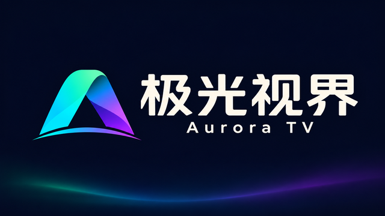
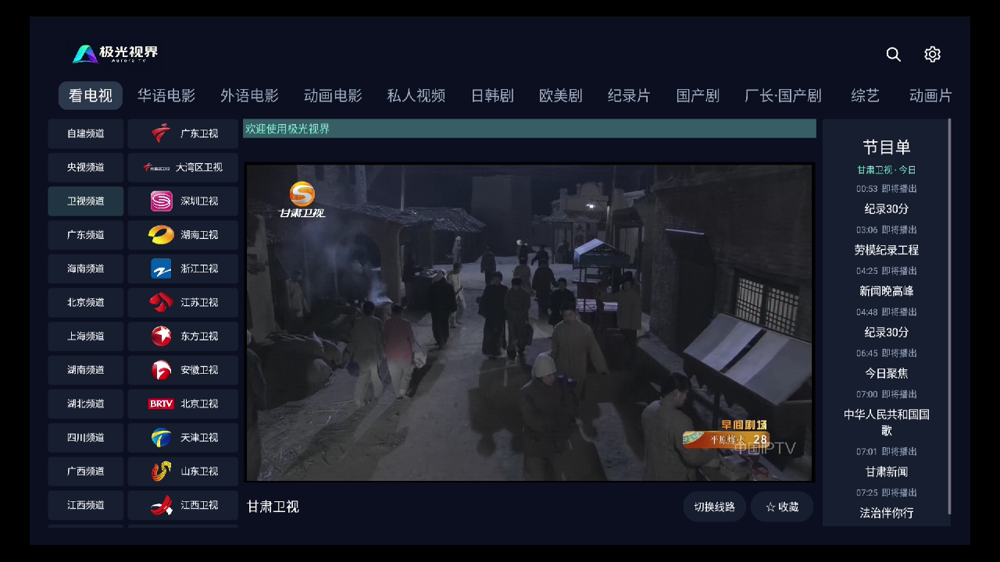
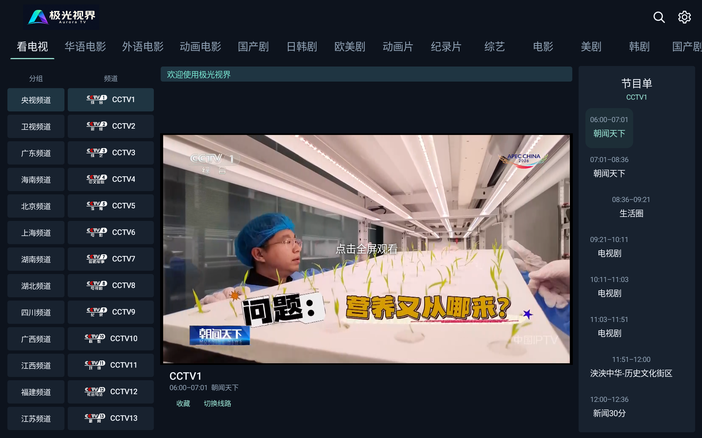
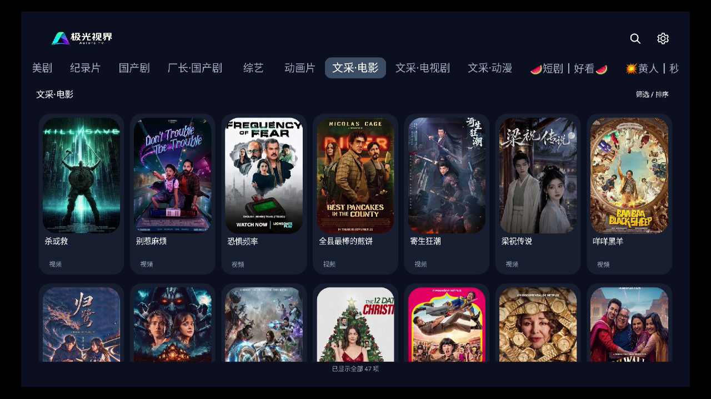
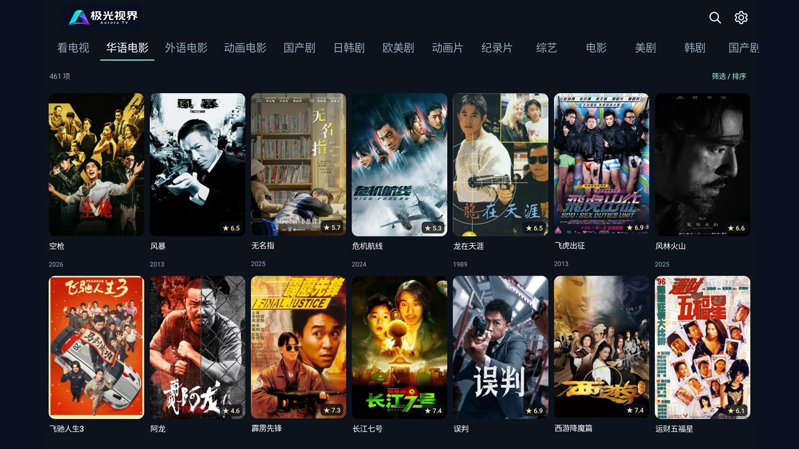

# 极光视界 · Aurora TV

基于原生 Android TV 开发的聚合式媒体播放平台, 采用Material Design 3风格视觉语言, 兼容 Android TV、机顶盒、手机、平板、车机, 支持遥控器、PC键盘与触屏操作。

# 设备要求

Android 5.0+，ARM64/ARM32 架构。

[下载最新安装包](https://github.com/heavenke/AuroraTV-Public/releases/latest/download/release.apk) · [更新日志](CHANGELOG.md)

## 功能

- **媒体聚合**　接入飞牛影视、Emby、Jellyfin 和 TVBox/影视仓，支持多站点、二级媒体库、搜索、筛选及自定义首页分类。
- **直播观看**　M3U/TXT 混合聚合，收藏、数字选台、多线路切换，EPG节目单支持 XMLTV、DIYP、超级直播格式与台标模板。
- **快速换台**　专项适配 rtp2httpd HTTP TS/FCC，保留完整地址参数，协调输入连接和画面交接。效果依服务端 FCC 能力、网络与终端解码性能而定。[rtp2httpd](https://github.com/stackia/rtp2httpd)
- **统一播放**　系统(MediaCodec)、VLC、IjkPlayer 三种播放引擎，提供续播、音轨、字幕、倍速与原始比例，按来源提供的历史能力支持回放与时移。
- **便捷操作**　扫码或本机 WebUI 配置，手机竖屏浏览、横屏播放，支持触控手势设置、清晰焦点与操作引导。
- **持续更新**　支持在线更新，长期维护。

## 界面

| 电视 | 平板 |
| --- | --- |
|  |  |
|  |  |

# 关于

本应用主体架构是自行设计, 部份实现由AI辅助开发。

本应用主体版权归 X-Team 所有并保留全部权利，未经授权不得进行逆向破解及收费分发。

本应用只提供解码播放功能, 媒体内容由用户自行配置的来源提供。

反馈时请附设备、Android 版本、引擎及复现步骤，并移除私有地址与凭据。

[第三方组件说明](THIRD_PARTY_NOTICES.md) · [第三方源码与替换材料](third-party/) · [库替换说明](Library-replacement.md)

Copyright © 2026 X-Team All Rights Reserved.
