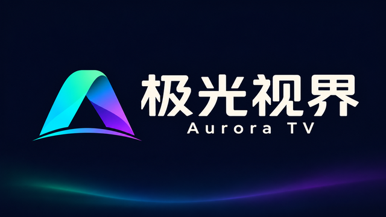
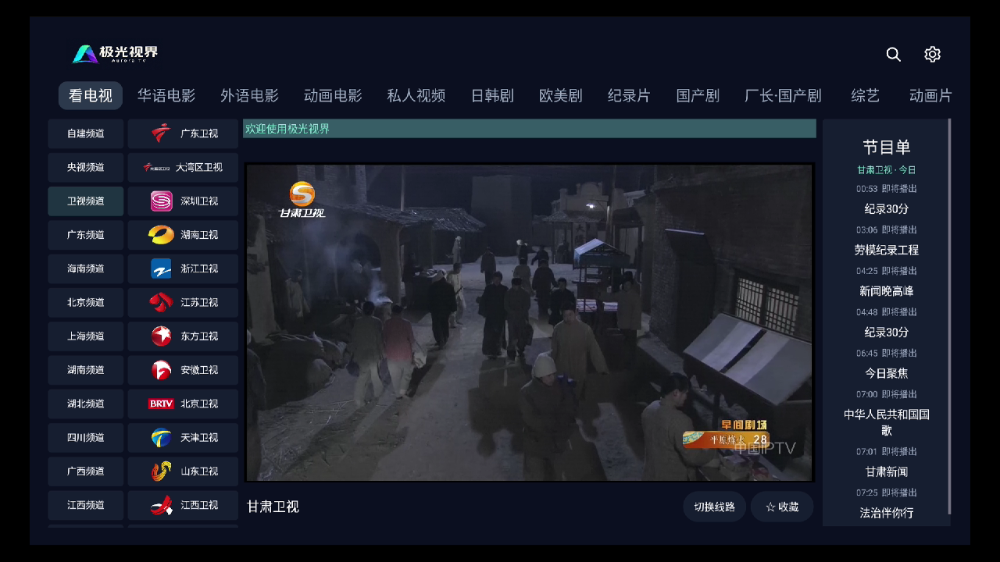
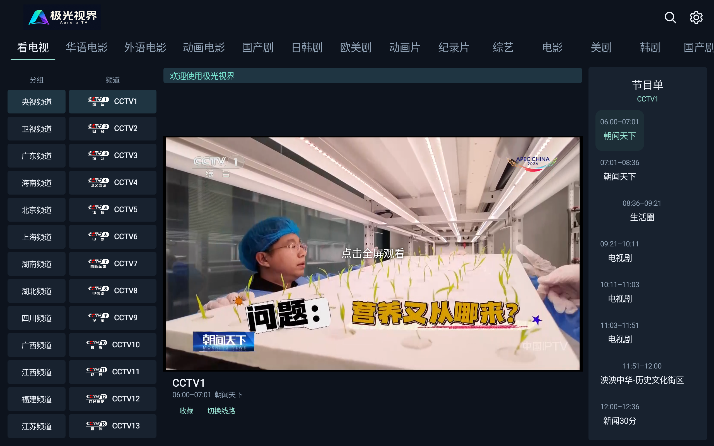
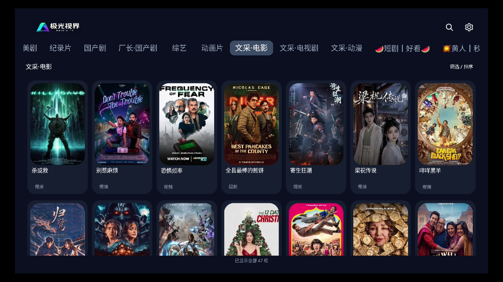
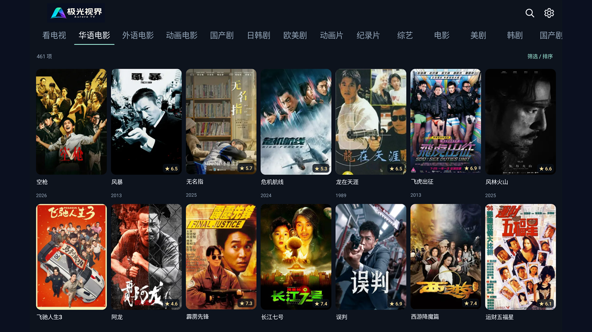
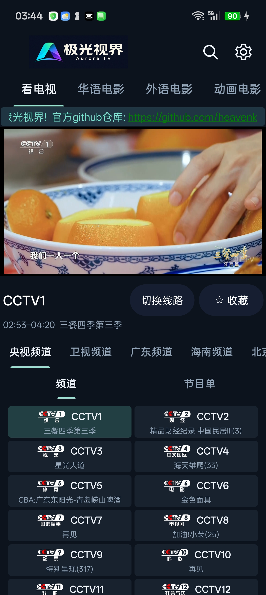
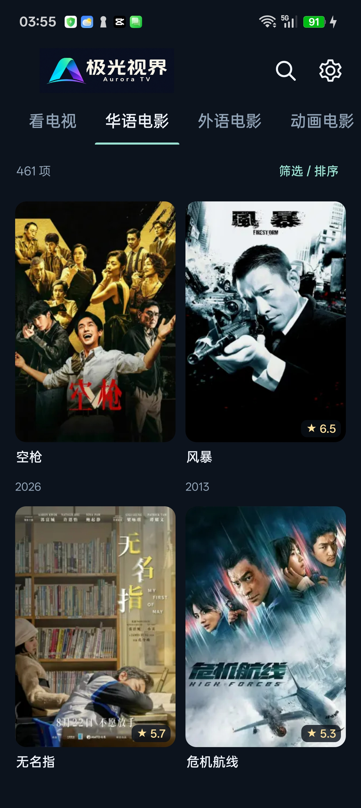

# 极光视界 · Aurora TV

  <a href="https://aurora-tv.com/"><strong>🌌 极光视界官网正式上线 · aurora-tv.com</strong></a> 
  界面预览 · 使用指南 · 应用下载

基于原生 Android TV 开发的聚合式媒体播放平台, 采用Material Design 3风格视觉语言, 兼容 Android TV、机顶盒、手机、平板、车机, 支持遥控器、PC键盘与触屏操作。

# 设备要求

Android 5.0+，ARM64/ARM32 架构。

[下载最新安装包](https://github.com/heavenke/AuroraTV-Public/releases/latest/download/release.apk) · [更新日志](CHANGELOG.md)

## 配置与使用教程

[📖 图文配置与使用教程（GitHub Wiki）](https://github.com/heavenke/AuroraTV-Public/wiki) · [官网使用指南](https://aurora-tv.com/guide/getting-started)

从安装和首次向导开始，了解直播、节目单、台标、点播来源、分类排序、播放操作与日志导出。

## 功能

- **媒体聚合**　接入飞牛影视、Emby、Jellyfin 和 TVBox/影视仓，支持多站点、二级媒体库、搜索、筛选及自定义首页分类。
- **直播观看**　M3U/TXT 混合聚合，收藏、数字选台、多线路切换，EPG节目单支持 XMLTV、DIYP、超级直播格式与台标模板。
- **快速换台**　专项适配 rtp2httpd HTTP TS/FCC，保留完整地址参数，协调输入连接和画面交接。效果依服务端 FCC 能力、网络与终端解码性能而定。[rtp2httpd](https://github.com/stackia/rtp2httpd)
- **统一播放**　MPV 单引擎统一播放直播、回放与点播，提供自动／硬解／软解、双渲染、续播、音轨、字幕、倍速与原始比例，按来源提供的历史能力支持回放与时移。
- **便捷操作**　扫码或本机 WebUI 配置，手机竖屏浏览、横屏播放，支持触控手势设置、清晰焦点与操作引导，支持点播长按临时 2× 快进。
- **持续更新**　支持在线更新，长期维护。

## 界面

截图来自早期版本；播放设置以当前 MPV 单引擎使用指南为准。

| 电视 | 平板 |
| --- | --- |
|  |  |
|  |  |

| 手机直播页 | 手机媒体库 |
| --- | --- |
|  |  |

# 关于

本应用主体架构是自行设计, 部份实现由AI辅助开发。

本应用主体版权归 X-Team 所有并保留全部权利，未经授权不得进行逆向破解及收费分发。第三方组件适用各自许可证，相关修改、调试与库替换权利见下方许可说明。

本应用只提供解码播放功能, 媒体内容由用户自行配置的来源提供。

反馈时请附设备、Android 版本、解码／渲染方式及复现步骤，并移除私有地址与凭据。

[第三方组件说明](THIRD_PARTY_NOTICES.md) · [第三方源码与替换材料](third-party/) · [库替换说明](Library-replacement.md)

Copyright © 2026 X-Team All Rights Reserved.
