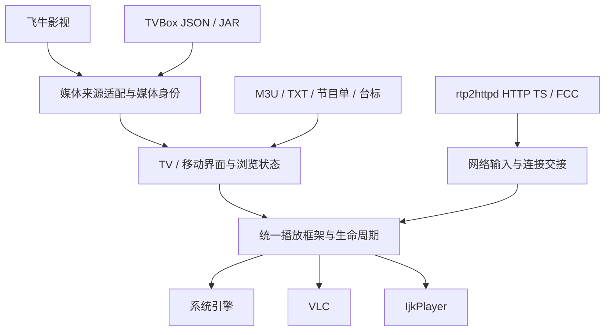

# 极光视界 · Aurora TV

极光视界是一款面向 Android 电视、电视盒子、平板与手机的媒体聚合播放器。它将直播频道与家庭媒体库放在统一的首页中，按照设备提供遥控器、键盘与触屏交互，通过你自行配置的媒体来源获取节目和影片。

当前版本 **v1.0.0.1112**，安装包为 `AuroraTV-v1.0.0.1112-release.apk`。应用支持 **Android 5.0 / API 21 及以上**，包含 **arm64-v8a、armeabi-v7a** 两种 ARM 架构。电视端与移动端共用媒体接入和播放框架，并分别安排适合大屏浏览及近距离触控的页面布局。

[下载最新版本](https://github.com/heavenke/AuroraTV-Public/releases/latest)

## 首页与媒体来源

首页以“看电视”为第一个分类，其后的分类可从已经接入的媒体库中选择。支持添加、移除、重命名与调整顺序，同一个媒体库保留一个首页分类。分类较多时可以横向滚动，电视遥控器和 PC 键盘均可继续向右浏览。

**飞牛影视**支持连接服务器并读取全部可访问媒体库，展示海报、背景、影片介绍、季集和实际媒体信息。媒体库采用持续向下滚动的浏览方式，支持排序和筛选，并保留未刮削视频及目录内容。STRM 按飞牛接口准备实际播放地址，使用来源所需的请求头和访问权限。

**TVBox JSON 与 Android Dex JAR**支持一个配置中的多个影视站点。站点及其二级分类可加入首页，详情、播放线路和资源解析保持对应的来源身份。配置内提供的直播订阅也可以进入直播源列表，由直播订阅功能统一选择或聚合。站点功能、搜索结果和可播放资源以对应来源实际提供的能力为准。

顶部搜索覆盖已经加入首页的媒体库，支持输入片名或演员关键词。结果保留来源身份，跨来源的同名内容可以分别打开。实际搜索匹配能力由媒体服务和站点接口共同决定。

## 直播与节目单

直播支持多个 M3U、TXT 订阅，可以单独使用一个订阅，也可以混合聚合多个订阅。频道按分组展示，支持收藏、数字选台、多线路切换与超时换源。部分订阅读取失败时会显示反馈，并保留其它有效频道。

频道面板采用分组、频道和节目入口的分栏布局，可展开日期与节目单。播放时的底部信息展示当前节目、接续节目、频道与实际播放状态，右侧控制面板提供线路、引擎、画面比例、视频信息及设置入口。

台标优先采用 M3U 中的 `tvg-logo`。缺少自定义台标时，可使用配置页填写的台标地址模板，支持 `{name}`、`{id}`、`{group}` 等占位符。节目单来源与台标来源可分别配置。

“看电视”页保留直播预览，确认当前频道后可进入全屏。离开直播分类时，预览连接会结束。预览上方的公告栏支持滚动显示，获得焦点或点击后可打开完整公告。

## 面向 rtp2httpd 的 HTTP TS / FCC 适配

极光视界针对 rtp2httpd 输出的 HTTP TS 直播链路做了专项适配。使用时应保留服务端生成的完整频道地址及 FCC 相关查询参数，并正确配置 rtp2httpd 服务端。地址参数、服务端 FCC 策略、编码方式与终端解码能力共同影响最终换台表现。[rtp2httpd 官方项目](https://github.com/stackia/rtp2httpd)

换台请求确定目标后，适用链路会提前建立该目标的单条 HTTP 输入，使网络准备与旧输入收尾交叠。提前读取的 TS 前缀会随同一个响应交给播放引擎，交接过程保留原始字节，并处理取消、短写和背压。缓冲区与连接生命周期有界，新请求、退出和后台切换会清理失效输入。

VLC 在适用的自动或硬件解码 HTTP TS 场景中，可以通过公开 Android API 的非阻塞文件描述符路径接收原始字节。该路径与普通网络输入共同纳入统一播放框架，按照实际媒体和设备条件选择。

直播预览与全屏共用视频宿主，切换观看区域时保留输出挂载关系。频道切换时分别管理旧画面与目标输入，以目标输入的实际帧状态确认交接，减少页面切换和输出窗口重建对观看的干扰。

FCC 的换台速度会随设备、播放引擎、编码参数、关键帧间隔和网络条件变化。使用 rtp2httpd 的完整 HTTP TS 地址，可以让服务端与客户端的相关适配协同工作。

## 播放与观看操作

应用接入系统、VLC、IjkPlayer 三种播放引擎。统一框架负责媒体身份、画面比例、播放状态、生命周期及错误恢复，具体解码由对应引擎与设备能力完成。默认使用原始画面比例，也可按内容选择其它显示方式。

点播支持暂停、续播、选集、倍速、可用音轨和字幕选择。本机字幕可以加载，并按当前引擎能力调整位置、大小和时间偏移。片头、片尾时长按当前剧集的季保存，同季的各集共用设置；可输入分钟和秒、使用方向键调整，或设为当前播放位置与剩余时长。

手机首页采用竖屏浏览，进入直播或点播全屏播放时自动切换横屏，退出后回到竖屏。触屏设备支持系统导航返回键，沿用播放器的关闭面板与返回规则。

遥控器长按左右键时，进度先在本地累加预览，松开后提交一次定位。触屏端支持左右滑动调整进度。这样的交互也有助于减少连续定位产生的资源请求。

电视点播播控支持左右移动直接切换对应功能页，向下进入具体选项。返回键先关闭展开的播控板，普通播放状态下采用再次返回退出的提示方式。

| 场景 | 常用操作 |
| --- | --- |
| 电视首页 | 左右切换分类，上下移动焦点 |
| 直播全屏 | 上下换台，OK / Enter 打开频道面板，向右切换线路 |
| 频道卡片 | 长按 OK 收藏或取消收藏，再次确认当前频道进入全屏 |
| 触屏直播 | 点击左侧区域打开频道面板，右侧区域打开控制面板 |
| 点播 | OK 控制播放或暂停，左右调整进度，向下进入播控 |

## 开始使用

1. 安装 Release APK，打开应用的“设置 → 配置管理”。
2. 手机扫描电视显示的二维码，或在同一局域网的 PC 浏览器打开设备显示的配置网址并配对。手机和平板也可点击“本机配置”，通过本机浏览器直接进入配置页面。
3. 在网页中添加直播订阅或点播来源，填写需要使用的节目单及台标模板。
4. 在“媒体库设置”选择首页分类，再按设备习惯调整播放引擎和通用设置。

配置操作会提供保存、加载或失败反馈。媒体来源决定内容与访问权限。网络存储、直链有效期和来源服务状态也会影响起播与定位。

应用支持在线更新、设备端更新日志查看，以及更新包的 SHA-256 和应用签名校验。

## 客户端架构与设计优势

浏览、来源与播放引擎分层，使不同媒体库能够共用页面与交互，同时保留各自的认证、分页和解析方式。网络读取在后台执行，切换来源或媒体时核对请求身份并取消旧任务，降低迟到结果覆盖当前页面的机会。统一播放框架让三种引擎沿用一致的画面比例、进度操作与资源释放规则。

## 界面预览

### 电视直播

### 平板直播

### 电视媒体库

### 平板媒体库

## 反馈与第三方组件

反馈问题时，请附上设备型号、Android 版本、播放引擎和复现步骤，并移除账号、会话及私有播放地址。版本说明与安装包统一在 Releases 提供。[版本与下载](https://github.com/heavenke/AuroraTV-Public/releases/latest)

极光视界应用主体采用闭源分发，本仓库用于产品介绍、界面展示和版本发布。VLC、IjkPlayer、Media3 等第三方组件保留各自版权、许可证及相应源码获取权利，相关通知随应用提供。[第三方通知](THIRD_PARTY_NOTICES.md)

Copyright © 2026 X-Team All Rights Reserved.
